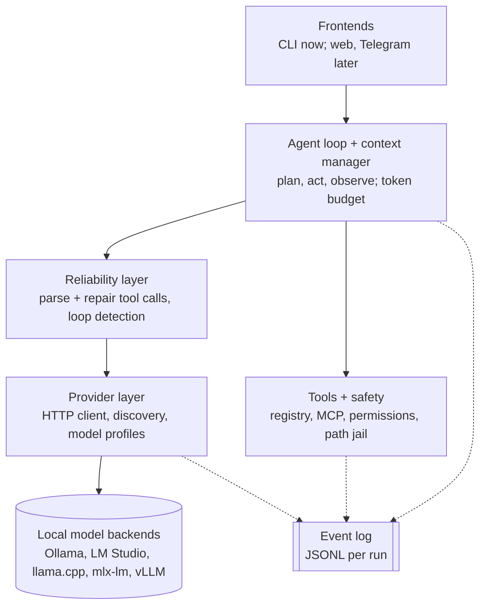
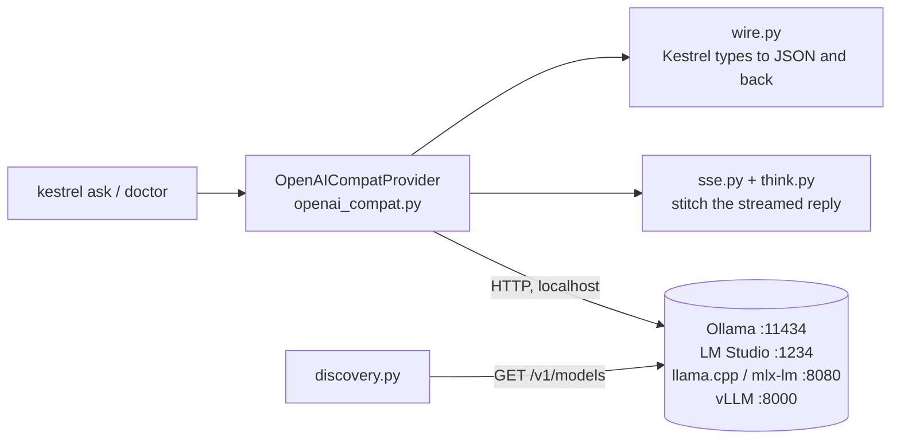

# Kestrel

[](https://github.com/JagdeepSingh13/kestrel/actions/workflows/ci.yml)

**The agent harness that makes small local models work.**

Kestrel is a local-first, model-agnostic agent harness for 3B to 14B models on an ordinary 16GB laptop. It plugs into any OpenAI-compatible backend (Ollama, LM Studio, llama.cpp, mlx-lm, vLLM), defines agents as YAML files, and fixes the tool-calling mistakes small models make.

> **Status: early development (v0.0.1).** Kestrel can find local backends and chat with a model (`kestrel doctor`, `kestrel ask`). No agent loop or tools yet. See the [roadmap](#roadmap).

## Planned features
- **Reliability:** repairs broken JSON, wrong tool names and bad arguments; detects loops; constrained decoding where the backend supports it.
- **Autotuning:** `kestrel tune` finds the best harness settings for your model.
- **Recipes:** turns a successful run into a fast, replayable recipe.
- **Safe by default:** per-tool permissions, workspace path jail, confirmation before side effects, web content treated as untrusted.
- **Inspectable:** every run writes a JSONL event log you can trace, replay and evaluate.
- **Coder agent (planned):** a built-in agent for software development on small local models: reads the repo, makes small edits, runs tests, fixes failures.

## How Kestrel works

This section explains every part of Kestrel in plain words. It grows with each milestone; parts marked *planned* don't exist yet.

### What is an agent harness?
- **Model** (Qwen, Gemma, Llama) is the engine. Kestrel doesn't build or run models; a backend like Ollama does.
- **Harness** (Kestrel) is the car around the engine: it sends the model a prompt, reads its answer, runs the tools it asks for, feeds the results back, and repeats until the task is done. It also catches the model's mistakes and keeps you safe.
- **Agent** is one trip setup: a YAML file naming the model, the prompt, the tools and the limits.
- **Tools** are attachments: files, shell, Python, web, or any MCP server.

Small models (3B to 14B) make predictable mistakes: broken JSON, wrong tool names, endless loops. Kestrel's job is to make them work anyway.

### The layers



Each layer only talks to the layers below it, so any piece can be swapped or tested alone.

| Layer | What it does, in plain words | Status |
|---|---|---|
| Frontends | Where you type. Today: the `kestrel` command. | `doctor`, `ask` (M1) |
| Agent loop + context | The repeat-until-done cycle; decides what fits in the model's small memory each turn. | *planned, M2* |
| Reliability | Turns messy model output into valid tool calls; stops loops. | *planned, M4* |
| Tools + safety | Runs tools; asks before risky actions; blocks files outside the workspace. | *planned, M3* |
| Providers | Talks HTTP to the model program on your machine. | done (M1); model profiles later |
| Event log | Writes every step to a file so runs can be inspected and replayed. | *planned, M2* |

### Providers: talking to the model (M1)
Kestrel never runs a model itself. A **backend** (Ollama, LM Studio, llama.cpp, mlx-lm, vLLM) loads the model and listens on a local port. All of them speak the same HTTP format, called "OpenAI-compatible" (OpenAI invented it; local programs copied it). So one small client covers them all.



What each piece does:
- **`core/types.py`**: Kestrel's own words for a conversation: `Message`, `ToolCall`, `ModelResponse`, `StreamChunk`. Everything above the provider layer uses only these, never the backend's JSON.
- **`core/config.py`**: reads `~/.config/kestrel/config.toml` (optional). Knows the four default backends; you can add your own. API keys are never stored in the file, only the name of the environment variable that holds them.
- **`providers/wire.py`**: translates Kestrel messages into the JSON the backend expects, and the backend's reply back into a `ModelResponse`.
- **`providers/sse.py`**: a streamed reply arrives as many small `data: {...}` lines. This stitches them back into text pieces and, at the end, one complete reply (including tool calls split across lines).
- **`providers/think.py`**: some models write their reasoning inside `<think>...</think>`. This separates it from the answer, even when a tag is split across two pieces.
- **`providers/openai_compat.py`**: the HTTP client. Retries only if the backend is not up yet (connection refused); never repeats a reply that already started. Turns every failure into a clear error.
- **`providers/discovery.py`**: checks every known backend at once and reports what is running, which models it has, and warnings (see below).
- **`providers/fake.py`**: a pretend model with scripted replies, so tests never need a real one.

Things worth knowing:
- **Thinking.** qwen3 thinks before answering. Ollama sends that thinking in a separate `reasoning` field; Kestrel keeps it apart from the answer. `kestrel ask --show-thinking` prints it dimmed. Add `/no_think` to a prompt to skip it (much faster on a laptop).
- **Ollama context.** On machines with under 24GB of GPU memory (all 16GB Macs), Ollama gives models only 4K tokens of memory. Kestrel needs 8K to 16K. Raise it in the Ollama app (Settings, Context length) or run `OLLAMA_CONTEXT_LENGTH=16384 ollama serve`. `kestrel doctor` reminds you; `ollama ps` shows the current value.
- **REMOTE.** Any backend that is not on this machine is labelled `REMOTE`: your prompt leaves your computer.

Try it:

```bash
uv run kestrel doctor
uv run kestrel ask "Say hello in five words." --model qwen3:8b
```

`ask` prints only the answer on standard output (so `> answer.txt` works); progress, thinking and token counts go to standard error.

### What exists today (M1)
- `kestrel doctor`: finds running backends and their models.
- `kestrel ask "..." --model M [--provider P] [--show-thinking]`: one message, streamed answer. No agent, no tools.
- Tests: unit tests with a fake network and recorded real Ollama replies (`uv run pytest`); live tests against a running Ollama (`uv run pytest -m live`).
- Quality checks on every push (GitHub Actions, macOS + Ubuntu + Windows): ruff (style, likely bugs), pyright (types), pytest (tests).

### Diagrams
All diagrams live in [docs/diagrams/](docs/diagrams/) and render on GitHub.

| Diagram | Shows |
|---|---|
| [architecture.md](docs/diagrams/architecture.md) | The layers above, with code folders and milestones |
| [core-types.md](docs/diagrams/core-types.md) | Kestrel's message and error types |
| [providers.md](docs/diagrams/providers.md) | Provider structure, `ask` sequence, `doctor` flowchart, data before and after |

## Install (development)
Requires [uv](https://docs.astral.sh/uv/).

```bash
git clone https://github.com/JagdeepSingh13/kestrel.git
cd kestrel
uv sync
uv run kestrel --version
uv run kestrel doctor
```

For a real chat you need a backend with a model, e.g. [Ollama](https://ollama.com) and `ollama pull qwen3:8b`.

## Roadmap
| Milestone | Scope | Status |
|---|---|---|
| M0 | Scaffold, CI on macOS/Ubuntu/Windows | done |
| M1 | Providers, `kestrel doctor`, `kestrel ask` | done |
| M2 | Agent loop, event log, `kestrel trace` | next |
| M3 | Agent YAML, file/shell/python tools, safety | |
| M4 | Reliability layer, web tools | |
| M5 | Interactive chat, MCP client | |
| M5.5 | Coder agent: repo map, small edits, run tests (tentative) | |
| M6+ | Memory, evals, autotuner, recipes | |

Full design: [docs/SPEC.md](docs/SPEC.md).

## Contributing
See [CONTRIBUTING.md](CONTRIBUTING.md).

## License
[Apache-2.0](LICENSE)
