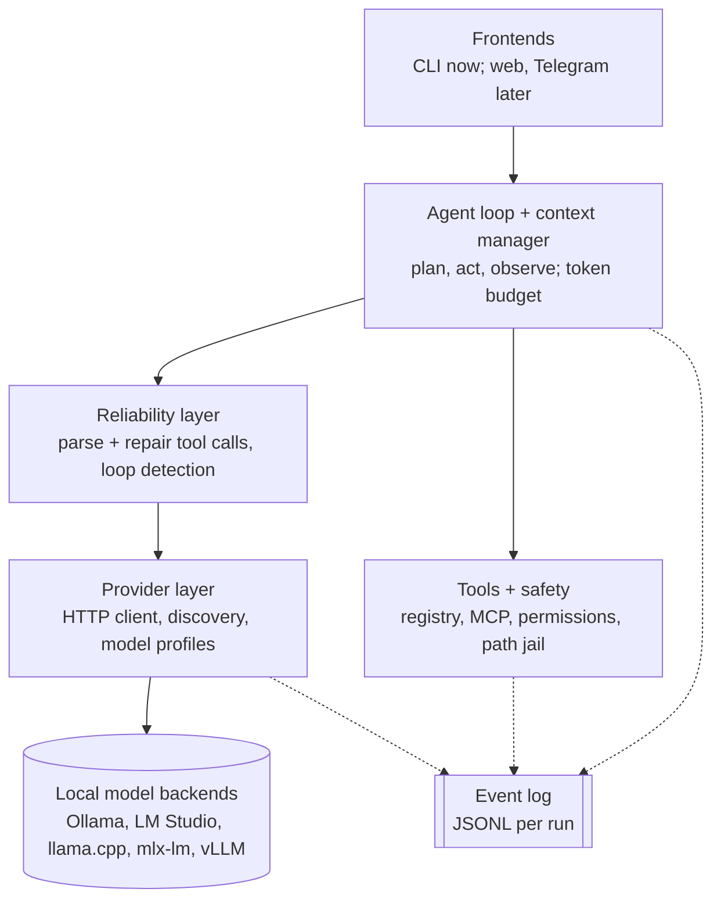

# Kestrel

[](https://github.com/JagdeepSingh13/kestrel/actions/workflows/ci.yml)

**The agent harness that makes small local models work.**

Kestrel is a local-first, model-agnostic agent harness for 3B to 14B models on an ordinary 16GB laptop. It plugs into any OpenAI-compatible backend (Ollama, LM Studio, llama.cpp, mlx-lm, vLLM), defines agents as YAML files, and fixes the tool-calling mistakes small models make.

> **Status: early development (v0.0.0).** Only the project scaffold exists. Nothing useful runs yet. See the [roadmap](#roadmap).

## Planned features
- **Reliability:** repairs broken JSON, wrong tool names and bad arguments; detects loops; constrained decoding where the backend supports it.
- **Autotuning:** `kestrel tune` finds the best harness settings for your model.
- **Recipes:** turns a successful run into a fast, replayable recipe.
- **Safe by default:** per-tool permissions, workspace path jail, confirmation before side effects, web content treated as untrusted.
- **Inspectable:** every run writes a JSONL event log you can trace, replay and evaluate.
- **Coder agent (planned):** a built-in agent for software development on small local models: reads the repo, makes small edits, runs tests, fixes failures.

## How Kestrel works

This section explains every part of Kestrel in plain words. It grows with each milestone; parts marked *planned* don't exist yet.

### What is an agent harness?
- **Model** (Qwen, Gemma, Llama) is the engine. Kestrel doesn't build or run models; a backend like Ollama does.
- **Harness** (Kestrel) is the car around the engine: it sends the model a prompt, reads its answer, runs the tools it asks for, feeds the results back, and repeats until the task is done. It also catches the model's mistakes and keeps you safe.
- **Agent** is one trip setup: a YAML file naming the model, the prompt, the tools and the limits.
- **Tools** are attachments: files, shell, Python, web, or any MCP server.

Small models (3B to 14B) make predictable mistakes: broken JSON, wrong tool names, endless loops. Kestrel's job is to make them work anyway.

### The layers



Each layer only talks to the layers below it, so any piece can be swapped or tested alone.

| Layer | What it does, in plain words | Status |
|---|---|---|
| Frontends | Where you type. Today: the `kestrel` command. | `kestrel --version` works (M0) |
| Agent loop + context | The repeat-until-done cycle; decides what fits in the model's small memory each turn. | *planned, M2* |
| Reliability | Turns messy model output into valid tool calls; stops loops. | *planned, M4* |
| Tools + safety | Runs tools; asks before risky actions; blocks files outside the workspace. | *planned, M3* |
| Providers | Talks HTTP to the model program on your machine. | *planned, M1* |
| Event log | Writes every step to a file so runs can be inspected and replayed. | *planned, M2* |

### What exists today (M0)
- `src/kestrel/cli/app.py`: the `kestrel` command (Typer). Only `--version` and `--help`.
- `tests/`: smoke tests that the command starts.
- Quality checks on every push (GitHub Actions, macOS + Ubuntu + Windows): ruff (style, likely bugs), pyright (types), pytest (tests).

### Diagrams
All diagrams live in [docs/diagrams/](docs/diagrams/) and render on GitHub.

| Diagram | Shows |
|---|---|
| [architecture.md](docs/diagrams/architecture.md) | The layers above, with code folders and milestones |

## Install (development)
Requires [uv](https://docs.astral.sh/uv/).

```bash
git clone https://github.com/JagdeepSingh13/kestrel.git
cd kestrel
uv sync
uv run kestrel --version
```

## Roadmap
| Milestone | Scope | Status |
|---|---|---|
| M0 | Scaffold, CI on macOS/Ubuntu/Windows | done |
| M1 | Providers, `kestrel doctor`, `kestrel ask` | next |
| M2 | Agent loop, event log, `kestrel trace` | |
| M3 | Agent YAML, file/shell/python tools, safety | |
| M4 | Reliability layer, web tools | |
| M5 | Interactive chat, MCP client | |
| M5.5 | Coder agent: repo map, small edits, run tests (tentative) | |
| M6+ | Memory, evals, autotuner, recipes | |

Full design: [docs/SPEC.md](docs/SPEC.md).

## Contributing
See [CONTRIBUTING.md](CONTRIBUTING.md).

## License
[Apache-2.0](LICENSE)
