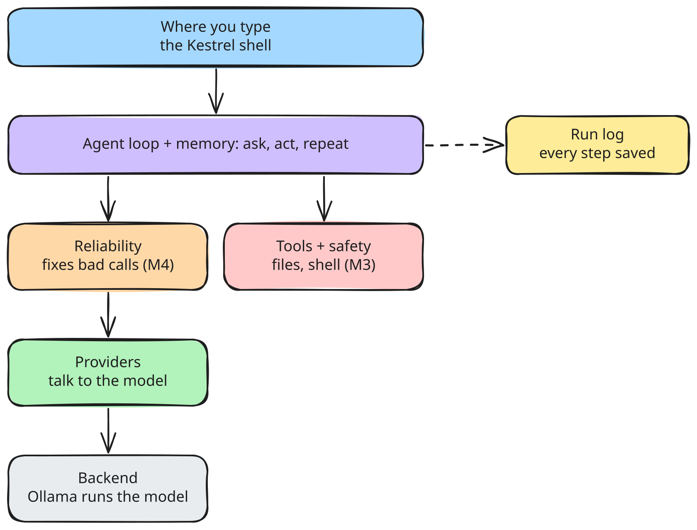
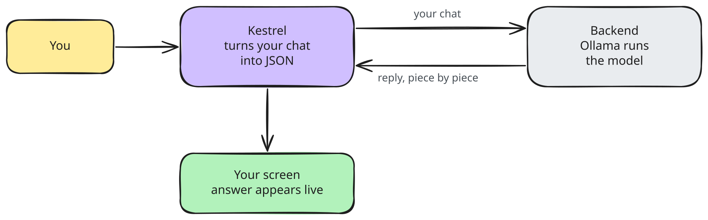
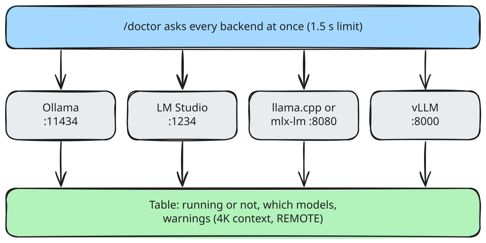
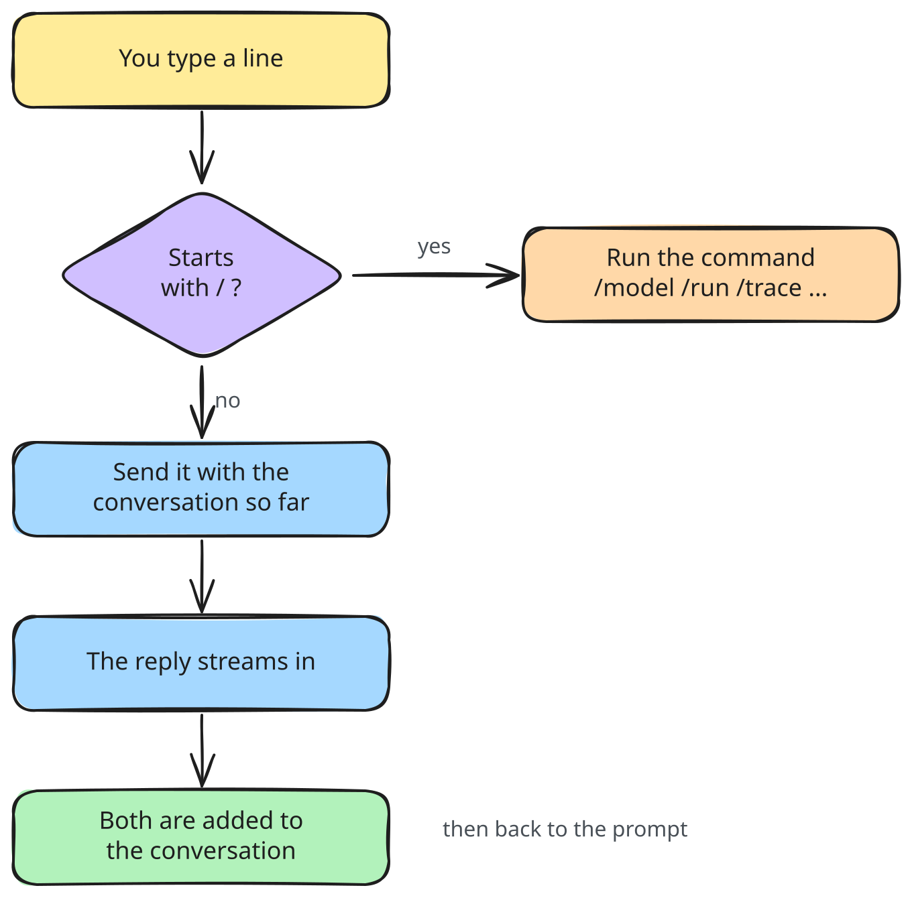
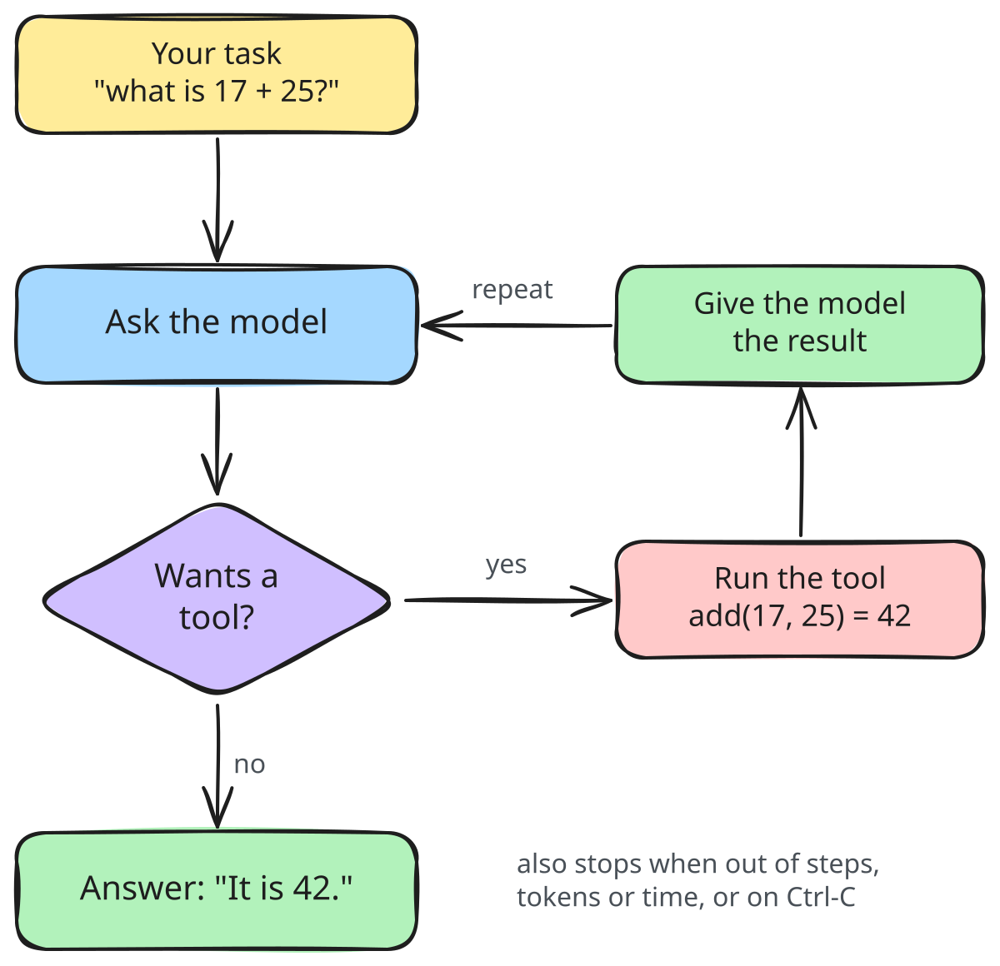
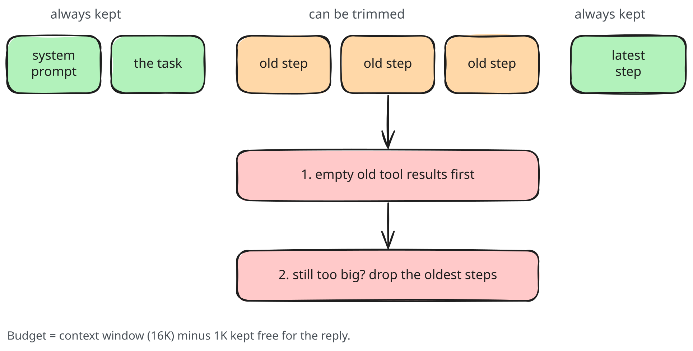
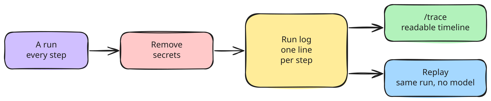

# Kestrel

[](https://github.com/JagdeepSingh13/kestrel/actions/workflows/ci.yml)

**The agent harness that makes small local models work.**

Kestrel is a local-first, model-agnostic agent harness for 3B to 14B models on an ordinary 16GB laptop. It plugs into any OpenAI-compatible backend (Ollama, LM Studio, llama.cpp, mlx-lm, vLLM), defines agents as YAML files, and fixes the tool-calling mistakes small models make.

> **Status: early development (v0.0.2).** Kestrel can chat with a local model in its own shell (`kestrel`) and run a basic agent loop with demo tools, logging every step (`kestrel run`, `kestrel trace`). Real tools arrive in M3. No agent loop or tools yet. See the [roadmap](#roadmap).

## Planned features
- **Step up only when stuck (headline):** each step runs on a small, fast model (like a 4B). If it gets stuck (broken tool calls, loops, repeated errors), Kestrel hands that one step to a bigger model, along with the conversation and a note on what failed, then steps back down. Cloud only if you allow it, with secrets removed and the exact text shown first. The trace shows which model did each step and why.
- **Reliability:** repairs broken JSON, wrong tool names and bad arguments; detects loops; constrained decoding where the backend supports it.
- **Autotuning:** `kestrel tune` finds the best harness settings for your model.
- **Recipes:** turns a successful run into a fast, replayable recipe.
- **Safe by default:** per-tool permissions, workspace path jail, confirmation before side effects, web content treated as untrusted.
- **Inspectable:** every run writes a JSONL event log you can trace, replay and evaluate.
- **Coder agent (planned):** a built-in agent for software development on small local models: reads the repo, makes small edits, runs tests, fixes failures.

## How Kestrel works

This section explains every part of Kestrel in plain words. It grows with each milestone; parts marked *planned* don't exist yet.

### What is an agent harness?
- **Model** (Qwen, Gemma, Llama) is the engine. Kestrel doesn't build or run models; a backend like Ollama does.
- **Harness** (Kestrel) is the car around the engine: it sends the model a prompt, reads its answer, runs the tools it asks for, feeds the results back, and repeats until the task is done. It also catches the model's mistakes and keeps you safe.
- **Agent** is one trip setup: a YAML file naming the model, the prompt, the tools and the limits.
- **Tools** are attachments: files, shell, Python, web, or any MCP server.

Small models (3B to 14B) make predictable mistakes: broken JSON, wrong tool names, endless loops. Kestrel's job is to make them work anyway.

### The layers



Each layer only talks to the layers below it, so any piece can be swapped or tested alone.

| Layer | What it does, in plain words | Status |
|---|---|---|
| Frontends | Where you type. Today: the `kestrel` command and its shell. | shell, `doctor`, `ask` (M1, M1.5) |
| Agent loop + context | The repeat-until-done cycle; decides what fits in the model's small memory each turn. | done (M2) |
| Reliability | Turns messy model output into valid tool calls; stops loops. | *planned, M4* |
| Tools + safety | Runs tools; asks before risky actions; blocks files outside the workspace. | *planned, M3* |
| Providers | Talks HTTP to the model program on your machine. | done (M1); model profiles later |
| Event log | Writes every step to a file so runs can be inspected and replayed. | done (M2) |

### Talking to the model (M1)
Kestrel never runs a model itself. A **backend** (Ollama, LM Studio, llama.cpp, mlx-lm, vLLM) loads the model and listens on a local port. All of them speak the same HTTP format, called "OpenAI-compatible" (OpenAI invented it; local programs copied it). So one small client covers them all.



How a reply travels:
1. Kestrel turns your conversation into the backend's JSON format and sends it.
2. The reply streams back in small pieces, so words appear as soon as the model writes them.
3. Kestrel stitches the pieces into one complete reply, and keeps the model's thinking apart from its answer.
4. If the backend is not up yet, Kestrel retries the connection twice. A reply that already started is never silently repeated.
5. Every failure becomes a plain message ("Nothing is listening at ... Is the backend running?") instead of a crash.

Finding backends (`kestrel doctor`): Kestrel knocks on every known port at once and asks each one for its model list. Each backend comes back as running, not running, or answering wrongly (bad key, wrong address).



Things worth knowing:
- **Thinking.** qwen3 thinks before answering. Kestrel keeps that apart from the answer and hides it unless you ask (`--show-thinking`, or `/think` in the shell). Add `/no_think` to a prompt to skip it; much faster on a laptop.
- **Ollama context.** On machines with under 24GB of GPU memory (all 16GB Macs), Ollama gives models only 4K tokens of memory. Kestrel needs 8K to 16K. Raise it in the Ollama app (Settings, Context length) or run `OLLAMA_CONTEXT_LENGTH=16384 ollama serve`. `kestrel doctor` reminds you; `ollama ps` shows the current value.
- **REMOTE.** Any backend that is not on this machine is labelled `REMOTE`: your prompt leaves your computer.
- **Settings.** Optional file `~/.config/kestrel/config.toml`: default model, default backend, extra backends. API keys never go in the file, only the name of the environment variable holding them.

### The interactive shell (M1.5)
Type `kestrel` and you are inside Kestrel's own prompt. Plain text goes to the model; lines starting with `/` control the session.



- The model "remembers" because every turn resends the whole conversation. `/clear` starts fresh.
- Ctrl-C stops a reply; that unfinished turn is dropped so the conversation stays clean. Ctrl-D or `/exit` leaves.
- `/model` lists the backend's models; `/model NAME` switches and keeps the conversation. Tab completes commands and model names. The up arrow recalls earlier lines.
- The conversation has to fit the model's memory (16K tokens). When it gets too long, the oldest messages are left out of what is sent (the shell still remembers them until `/clear`).

| Command | Does |
|---|---|
| `/help` | list commands |
| `/model [name]` | list models, or switch |
| `/provider [name]` | list backends, or switch |
| `/think [on\|off]` | show or hide the model's thinking |
| `/run TASK` | agent run with tools, shown live |
| `/trace [id] [--full]` | a run step by step (`/trace list` for recent runs) |
| `/clear` | forget the conversation |
| `/doctor` | check which backends are running |
| `/exit` | leave (also `/quit`, Ctrl-D) |

### The agent loop (M2)
An agent is a model that can use tools. The loop is what makes that work: the model cannot run anything itself, it can only *ask*. Kestrel runs what it asks for and shows it the result, again and again, until the model gives an answer.



- **Budgets** keep a confused model from running forever: at most 15 model calls by default, plus optional limits on total tokens and time. A run always ends with a clear reason: answered, out of steps, over budget, cancelled (Ctrl-C), or backend error.
- **Tool mistakes are not crashes.** A wrong tool name, bad arguments or a tool that breaks comes back to the model as `ERROR: ...`, so it can try again.
- **The model's memory is small.** Before every call, Kestrel fits the conversation into the model's context window. Old tool results are emptied first, then the oldest turns are dropped. The task and the latest step are always kept. A huge tool result is cut short; the full text stays in the log.
- **Thinking is recorded but not repeated.** The model's reasoning goes into the log, but is never sent back to it, which saves space.


- **Today's tools are toys:** `add` and `echo`, just enough to prove the loop on a real model. Real tools (files, shell, Python) come in M3.

Try it:

In the shell:

```
qwen3:8b> /run What is 17 + 25? Use the add tool, then echo the answer.
qwen3:8b> /trace
```

(From a normal terminal, `kestrel run "..." -m MODEL` and `kestrel trace last` do the same.)

### The run log (M2)
Every run writes a diary: one line per thing that happened (task received, model asked, model replied, tool called, tool answered, final answer, run ended). It is written as it happens, so even a crash leaves a complete record up to that point.



- **Secrets never reach the file.** Values of environment variables named like `*KEY*`, `*TOKEN*`, `*SECRET*`, `*PASSWORD*`, and well-known key formats, are replaced with `[REDACTED]` first.
- **Readable later.** `kestrel trace last` (or a run id) shows the timeline; `--full` shows full text including the model's thinking; `--list` shows recent runs.
- **Replayable.** A recorded run can be fed back through the loop without a model, which is how tests catch regressions, and later how evals and recipes work.
- Logs live in `~/.local/share/kestrel/runs/`, named by start time.

### What exists today
- `kestrel`: the interactive shell (also `kestrel chat --model M`).
- `kestrel run "task" --model M`: an agent run with the demo tools; `kestrel trace` to inspect it.
- `kestrel doctor`: finds running backends and their models.
- `kestrel ask "..." --model M`: one message, one streamed answer, for scripts.

### Diagrams
All diagrams are hand-drawn [Excalidraw](https://excalidraw.com) pictures in [docs/diagrams/img/](docs/diagrams/img/). To edit one, drag its `.excalidraw` file onto excalidraw.com; to redraw them all, see [docs/diagrams/README.md](docs/diagrams/README.md).

| Diagram | Shows |
|---|---|
| [architecture.md](docs/diagrams/architecture.md) | The layers above, with code folders and milestones |
| [core-types.md](docs/diagrams/core-types.md) | Kestrel's message and error types |
| [providers.md](docs/diagrams/providers.md) | Provider structure, `ask` sequence, `doctor` flowchart, data before and after |
| [shell.md](docs/diagrams/shell.md) | Shell structure, how a line is handled, session data |
| [agent-loop.md](docs/diagrams/agent-loop.md) | Loop structure, one run step by step, context budget, run log data |

## Install (development)
Requires [uv](https://docs.astral.sh/uv/).

```bash
git clone https://github.com/JagdeepSingh13/kestrel.git
cd kestrel
uv sync
uv run kestrel --version
uv run kestrel doctor
uv run kestrel          # interactive shell
```

For a real chat you need a backend with a model, e.g. [Ollama](https://ollama.com) and `ollama pull qwen3:8b`.

## Roadmap
| Milestone | Scope | Status |
|---|---|---|
| M0 | Scaffold, CI on macOS/Ubuntu/Windows | done |
| M1 | Providers, `kestrel doctor`, `kestrel ask` | done |
| M1.5 | Interactive shell (`kestrel`) | done |
| M2 | Agent loop, event log, `kestrel trace` | done |
| M3 | Agent YAML, file/shell/python tools, safety | next |
| M4 | Reliability layer, web tools | |
| M4.5 | Step up only when stuck: model ladder (local models) | |
| M5 | Interactive chat, MCP client | |
| M5.5 | Coder agent: repo map, small edits, run tests (tentative) | |
| M6+ | Memory, evals, autotuner, recipes | |

Full design: [docs/SPEC.md](docs/SPEC.md).

## Contributing
See [CONTRIBUTING.md](CONTRIBUTING.md).

## License
[Apache-2.0](LICENSE)
