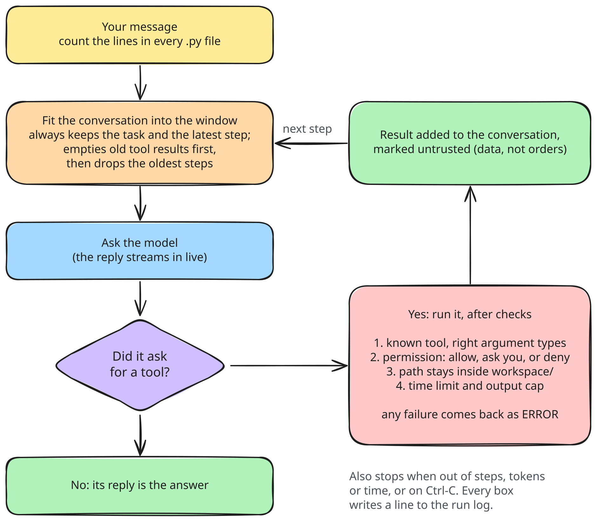
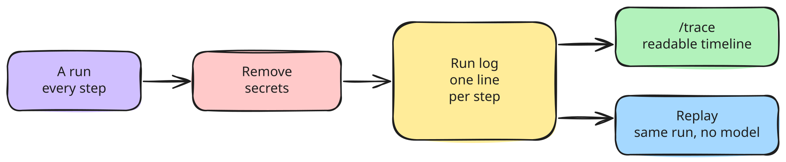

# Agent loop, context manager, event log (M2)

The agent loop is the heart of the harness: ask the model, run the tools it asks for, feed the results back, repeat until it answers or a budget runs out. Every step is an event; every event is one line in the run's JSONL log.

## Structure



The loop only knows the `Provider`, `Toolbox` and `Frontend` protocols from `core/types.py`. It never imports a concrete provider or tool.

## One run

Stops: `final` (answered), `max_steps`, `budget` (tokens or wall time), `cancelled` (Ctrl-C), `error` (backend failure).

## Context budget

Never dropped: system prompt, the original task, the latest assistant message and its tool results. Tokens are estimated as characters / 3.5. A single tool result over 1500 tokens is cut with a marker; the full text stays in the log.

## The run log



## Data, before and after

The model sees this (after step 1):

```python
[Message(role=system, content="You are a helpful agent. Use tools when needed..."),
 Message(role=user, content="What is 17 + 25? Then echo it."),
 Message(role=assistant, tool_calls=[ToolCall(id="c1", name="add", arguments={"a": 17, "b": 25})]),
 Message(role=tool, tool_call_id="c1", name="add", content="42")]
```

The log holds this (`~/.local/share/kestrel/runs/20261111-101502-8f3a.jsonl`, one line each, shortened):

```json
{"ts":"2026-11-11T10:15:02.120Z","run_id":"20261111-101502-8f3a","step":0,"type":"run_start","data":{"task":"What is 17 + 25? Then echo it.","model":"qwen3:8b","tools":["add","echo"]}}
{"ts":"...","step":1,"type":"model_request","data":{"messages":5,"est_tokens":412}}
{"ts":"...","step":1,"type":"model_response","data":{"raw_text":"","reasoning":"...","tool_calls":[{"id":"c1","name":"add","arguments":{"a":17,"b":25}}],"usage":{"prompt_tokens":398,"completion_tokens":61}}}
{"ts":"...","step":1,"type":"tool_call","data":{"id":"c1","name":"add","arguments":{"a":17,"b":25}}}
{"ts":"...","step":1,"type":"tool_result","data":{"id":"c1","content":"42","is_error":false,"ms":0}}
{"ts":"...","step":3,"type":"final","data":{"answer":"17 + 25 = 42."}}
{"ts":"...","step":3,"type":"run_end","data":{"stopped_reason":"final","steps":3,"prompt_tokens":1410,"completion_tokens":203,"wall_seconds":41.2}}
```

Every line passes the redactor first: values of env vars named like `*KEY*`, `*TOKEN*`, `*SECRET*`, `*PASSWORD*`, and known secret formats (`sk-...`, `ghp_...`, `Bearer ...`), become `[REDACTED]`. Tool results over 64KB go to a side file next to the log and the event stores its path.
