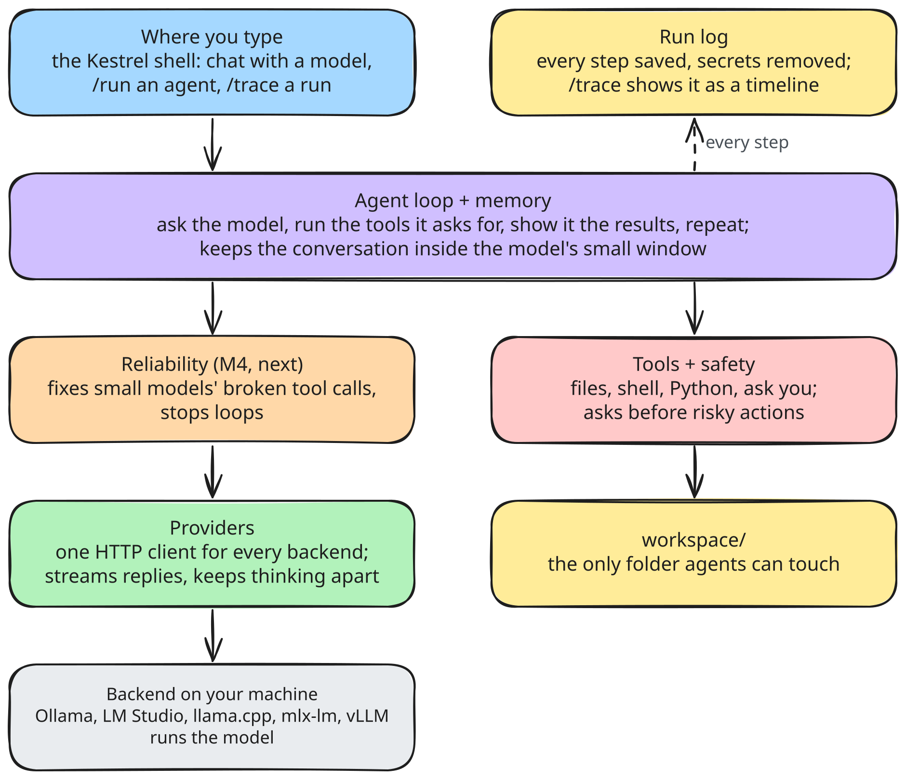

# Architecture

Layers, top to bottom. Each layer depends only on layers below it plus `core/types.py` (SPEC section 2). Every layer reports what it does to the event log.

| Layer | Code | Milestone |
|---|---|---|
| Frontends | `cli/` | M0 (stub), M1+ |
| Agent loop + context | `core/loop.py`, `core/context.py` | M2 |
| Reliability | `reliability/` | M4 |
| Tools + safety | `tools/`, `safety/` | M3, M5 (MCP) |
| Providers | `providers/` | M1 |
| Event log | `core/events.py` | M2 |
