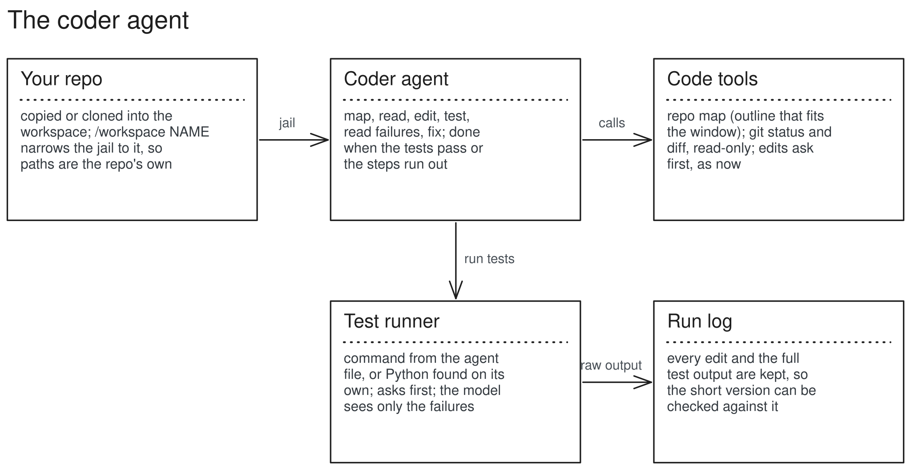

# The coder agent (M5.5)

A built-in `coder` agent that fixes failing tests in a small repo on `qwen3:8b`: map the repo, read, edit, run the tests, read the failures, fix, until the tests pass or the steps run out. The core loop does not change.

## Structure



### Repo folder
- You copy or clone the repo into the workspace (`~/Documents/kestrel-workspace/NAME`); `/workspace NAME` narrows the jail to it for the session (`/workspace` alone goes back). It only narrows: `..`, symlinks leading out and missing folders are refused. Paths and test names are then the repo's own; the status line shows `in NAME`.
- Switching clears the files-read memory and restarts running MCP servers in the new folder. Sessions save the folder and `/resume` returns to it.

### Tools
- `repo_map` (allow): an outline in about 1,200 tokens. Python files through `ast` (top-level functions with their arguments, classes with method names), other files by name. Over budget: names only, then files per folder, then "N more files". A file that does not parse shows `(syntax error line N)`.
- `run_tests` (confirm): the command comes from the agent file (`test_command`) or, for Python, is found by reading files only, so nothing in the repo runs before you approve (the repo's `.venv` Python if there is one, with pytest when the repo shows signs of it, else unittest; without a `.venv`, Kestrel's Python with pytest if installed). The model never writes the command. Timeout 120 s. The model gets a short version (below); the full output goes to the run log as a `test_run` event. A failing run counts as a failed tool call, so the watchdog and the after-failure nudge see it.
- `git_status`, `git_diff` (allow, read-only): hardened (no hooks, no fsmonitor, no external diff or textconv, no filters from `.gitattributes`; needs git 2.40+), and git cannot climb out of the jail into another repo. A clear error when git is missing or the folder is not a repo.

### Changes to existing tools
- File tools refuse writes inside `.git/`, in any letter case.
- Skipped folders gain `.pytest_cache`, `.tox`, `dist`, `build`, `target`.

## How a fix runs

1. `cp -R tests/fixtures/coder/calc ~/Documents/kestrel-workspace/`, then `/workspace calc` and `/agent coder`.
2. "the tests fail, fix it". The model calls `repo_map` (no question asked).
3. It calls `run_tests`; you approve (yes, or yes for this run). It sees `exit 1: 1 failed, 2 passed` and the failing block.
4. It reads `calc/stats.py` and the test, then `edit_file`; you see the changed lines and approve.
5. It runs `run_tests` again: `exit 0: 3 passed`. It answers with what it changed.
6. `git_diff` is there if it wants to check its own change. Every edit and every test run is in the run log.

## Data, before and after

```text
# raw (unittest, 30+ lines, full paths)
F..
======================================================================
FAIL: test_mean (tests.test_stats.TestStats.test_mean)
----------------------------------------------------------------------
Traceback (most recent call last):
  File "/Users/you/Desktop/kestrel/workspace/calc/tests/test_stats.py", line 7, in test_mean
    self.assertEqual(mean([2, 4, 6]), 4)
AssertionError: 6.0 != 4
----------------------------------------------------------------------
Ran 3 tests in 0.001s

FAILED (failures=1)

# what the model is given
<untrusted source="run_tests">
exit 1: 1 failed, 2 passed (0.0s)
FAIL: test_mean (tests/test_stats.py:7)
    self.assertEqual(mean([2, 4, 6]), 4)
AssertionError: 6.0 != 4
</untrusted>
```

Budget for the short version: about 2,000 characters, at most 3 failure blocks of 12 lines; more failures by name only. Output it cannot parse: first and last 25 lines.

## Later
Lint (`run_check`); test auto-detection for npm, cargo and go (they can download); regex search; outlines for other languages; `/undo`; git write tools; `kestrel run --in NAME`. An "unverified" nudge (an answer after an edit with no passing test run) only if the live run shows the model claiming a fix without testing.

Done when: on `qwen3:8b`, the coder agent fixes the failing test in the `calc` fixture end to end, every edit confirmed and logged.
