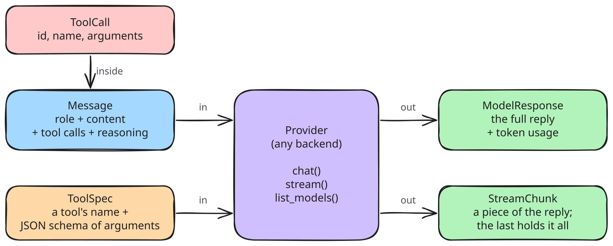

# Core types (M1)

`core/types.py` is the shared language of every layer. Providers convert wire formats into these types; nothing above `providers/` ever sees raw JSON from a backend.

Errors (all subclass `ProviderError`, so callers can catch one type):

| Error | When | What the user sees |
|---|---|---|
| `BackendUnreachableError` | connection refused / DNS fails (after retries) | "Nothing is listening at http://localhost:11434. Is Ollama running?" |
| `BackendTimeoutError` | no response within the timeout | which phase timed out |
| `BackendHTTPError` | 4xx/5xx | status + first 500 chars of the body (e.g. "model not found") |
| `BadBackendResponseError` | response isn't the expected JSON | what was missing |

`JSONValue` is a recursive type alias (str, int, float, bool, None, list, dict) used instead of `Any` for tool arguments and JSON Schemas.
