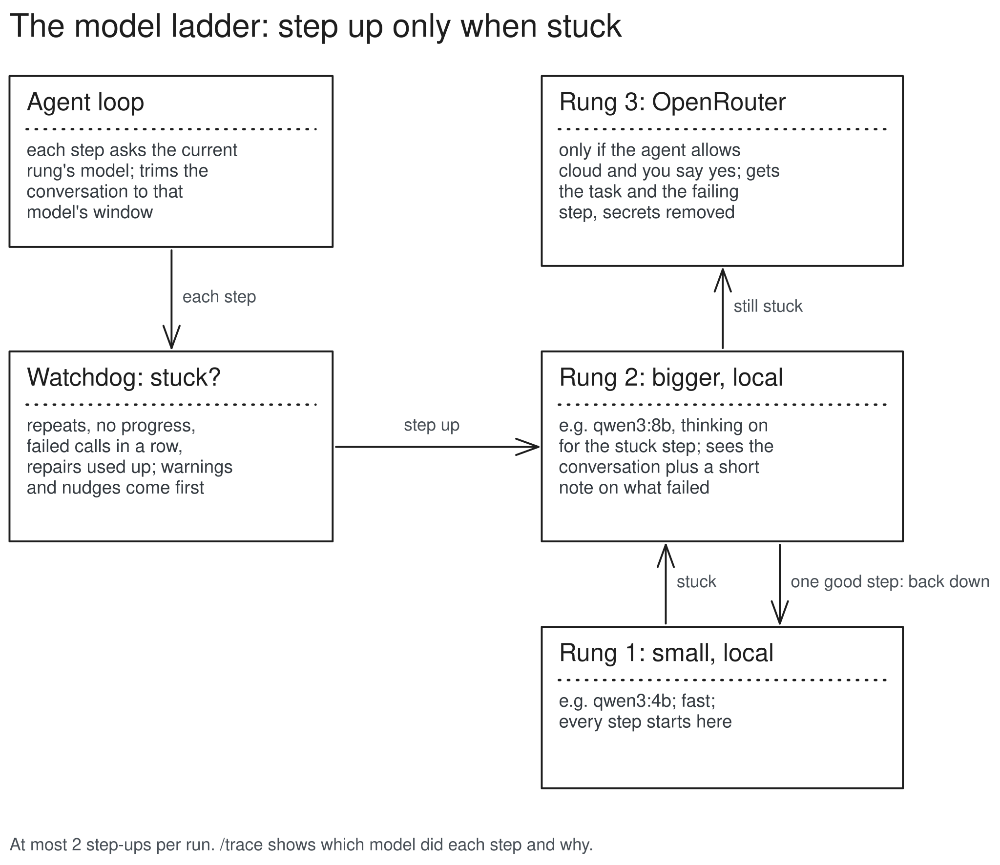

# The model ladder (M4.5)

Every step runs on the smallest model. When the watchdog says the run is stuck, that step goes to the next, bigger model with a short note on what failed; after one good step, the run steps back down. The top rung may be an OpenRouter model, only when the agent allows cloud and you say yes.

## Structure



- `core/types.py`: a `Ladder` protocol: `current()` returns a `Rung` (provider, model, window, think, label); `step_up(reason, detail)` returns the next rung or None (none left, or a cloud step you declined); `after_step(ok)` returns the rung to step back down to, or None. The loop only knows this protocol and `Provider`; it reads the current rung every step and sets the context window from it.
- `run_agent` keeps working with one `provider` and `model`: they become a one-rung ladder.
- `cli/ladder.py`: the real ladder. Opens each rung's provider lazily, probes a local rung on its first use (a model without tools is skipped with a warning), asks you before a cloud step, builds the cloud payload and redacts it.
- `providers/openrouter.py`: one GET of OpenRouter's model list (models with tools), only on `/model` or the first cloud use; gives the window, tool support and free or paid. Cached with the profiles. OpenRouter is not a built-in provider (`/doctor` would contact it): add `[providers.openrouter]` with `base_url = "https://openrouter.ai/api/v1"` and `api_key_env = "OPENROUTER_API_KEY"` to your config.
- Agent files: `model: [qwen3:4b, qwen3:8b, "openrouter:google/gemma-4-26b-a4b-it:free"]`. A prefix that names a configured provider picks it; a name without one runs on your local default backend, whatever provider the shell is on (`qwen3:8b` keeps working). `/ladder` shows `qwen3:8b (ollama) then openrouter:...` and refuses `baidu/ernie...:free` without the `openrouter:` prefix.
- Shell: `/ladder` shows it, `/ladder A B C` sets it for the session, `/up` starts the next message one rung higher.
- Since the owner's test (2026-11-14): `/retry up` sends your last message to the next model with the answer you rejected; `/cloud setup` picks a free OpenRouter model and turns cloud on for the session (`/cloud on|off`); the status line shows `qwen3:8b ↑ <model> (cloud on|off)`.

## How a step-up runs

1. The watchdog (or repair) reports stuck: repeats, no progress, failed calls in a row, repairs used up. Warnings and nudges come first; they never step up. Context overflow steps up only to a local rung with a bigger window.
2. The ladder picks the next rung. A local rung is probed on first use (that also loads it).
3. For OpenRouter: cloud must be on (`/cloud on`, or `allow_cloud: true` in the agent file) and the key must be set; before every step that goes up to it you are asked "Send this stuck step to google/gemma-4-26b-a4b-it:free on openrouter (free)?" with what is and is not sent: Yes / Yes, and don't ask again this run / No. "No" stops the run.
4. The conversation is rebuilt for the new rung's window, plus one note as a user message: "(Kestrel: a smaller model (qwen3:4b) got stuck here: repeat (read_file called 4 times). You are a bigger model taking over this step. Do not repeat what failed; take another approach.)". The cloud gets only the system prompt, the task, the note and the failing step, never the older history, with secrets removed.
5. Thinking is on while the bigger model has the run, if it can think.
6. After one good step (a tool result that is not an error) the run steps back down; a final answer simply ends the run. At most 2 step-ups per run; after the second it stays up. If the top rung is stuck too, the run stops as today.

## Data, before and after

```text
# before (M4): the run stops
⏺ read_file(data/sales.csv)            (4th time)
  stuck: repeat
  Stopped: stuck · 6 steps

# after (M4.5): the run steps up and finishes
⏺ read_file(data/sales.csv)            (4th time)
  ↑ stepped up to qwen3:8b: repeat (read_file called 4 times)
⏺ python_exec(...)
  ⎿  151600.0
  ↓ back to qwen3:4b
⏺ The total revenue is 151,600.
  8 steps · qwen3:4b 7, qwen3:8b 1 · 9.1K tokens · 41s

# run log
{"type": "step_up", "data": {"from": "qwen3:4b", "to": "qwen3:8b", "reason": "repeat", "detail": "read_file called 4 times"}}
{"type": "step_down", "data": {"from": "qwen3:8b", "to": "qwen3:4b"}}
```

Rate limits: OpenRouter's free models allow 20 requests a minute and 50 a day (1,000 a day after buying 10 credits). A limit hit ends the run with a plain message, no retry.
