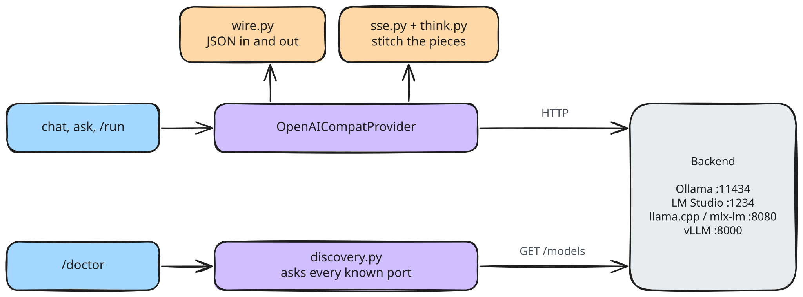
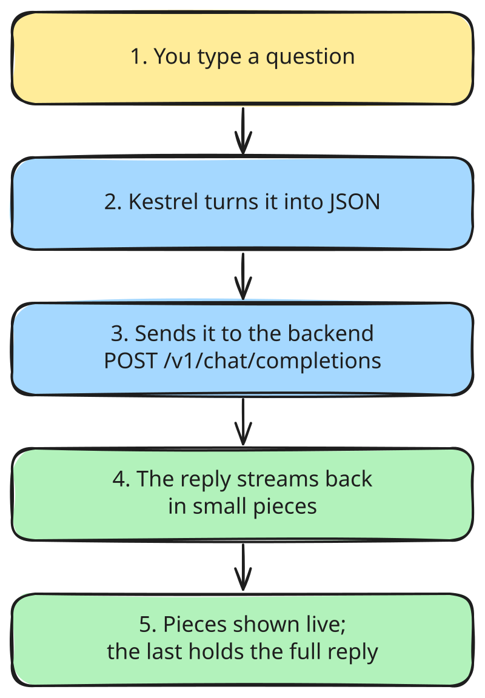
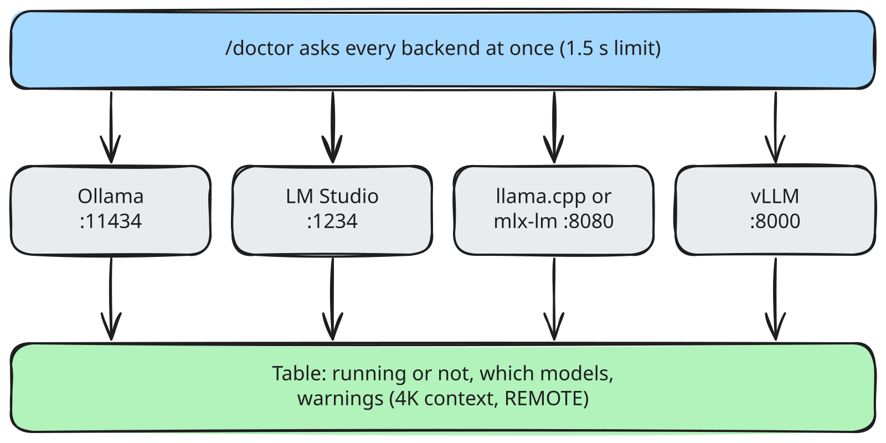

# Provider layer (M1)

The provider layer is the only code that talks to model backends. Everything above it speaks Kestrel's own types (`core/types.py`); wire formats (OpenAI JSON, SSE) exist only inside `providers/`.

## Structure



## `kestrel ask "hello"` (streaming)



Retries: only when the connection fails **before** any byte arrives (backend not up yet). A generation that started is never retried silently.

Output split: the answer goes to stdout, everything else (spinner, `--show-thinking` reasoning, token counts, `REMOTE` label, errors) goes to stderr, so `kestrel ask "..." > answer.txt` saves only the answer. Model comes from `--model`, else `default_model`; provider from `--provider`, else `default_provider`. Exit code 0 ok, 1 backend error, 2 usage or config error, 130 Ctrl-C.

## `kestrel doctor`



Three outcomes per backend: `up` (model list read), `down` (nothing listening) and `error` (something answered, but not with a model list: bad key, wrong URL). Probes are not retried, so doctor finishes in about 1.5s. Exit code 0 if any backend is up, 1 if none, 2 for a broken `config.toml`.

## Data, before and after

What Kestrel holds internally:

```python
[Message(role=Role.system, content="Be brief."),
 Message(role=Role.user, content="hello")]
```

What `wire.py` sends (`POST /v1/chat/completions`):

```json
{"model": "qwen3:8b",
 "messages": [{"role": "system", "content": "Be brief."},
              {"role": "user", "content": "hello"}],
 "temperature": 0.2,
 "stream": true,
 "stream_options": {"include_usage": true}}
```

What streams back (Server-Sent Events, one `data:` line per piece):

```
data: {"choices":[{"index":0,"delta":{"role":"assistant","content":"Hi"}}]}
data: {"choices":[{"index":0,"delta":{"content":" there!"}}]}
data: {"choices":[{"index":0,"delta":{},"finish_reason":"stop"}]}
data: {"choices":[],"usage":{"prompt_tokens":14,"completion_tokens":3}}
data: [DONE]
```

What Kestrel turns it into:

```python
StreamChunk(text="Hi")
StreamChunk(text=" there!")
StreamChunk(done=ModelResponse(
    message=Message(role=Role.assistant, content="Hi there!"),
    raw_text="Hi there!", finish_reason="stop",
    usage=Usage(prompt_tokens=14, completion_tokens=3)))
```

Tool calls arrive in pieces too (`delta.tool_calls[i].function.arguments` is a string split across events); `sse.py` stitches them back into one `ToolCall` with parsed `arguments`.
