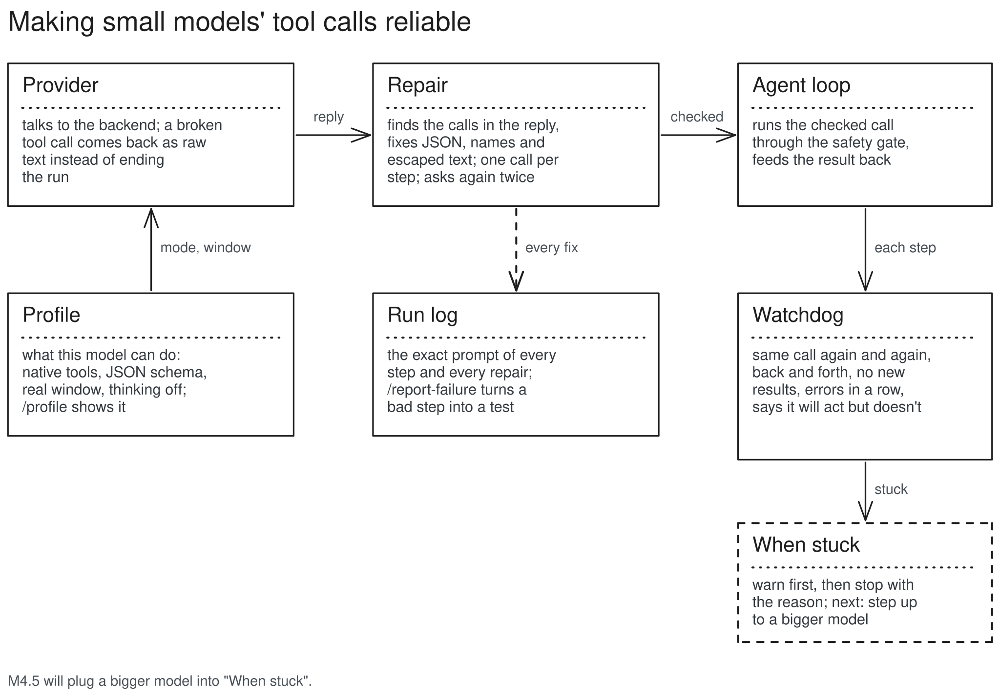
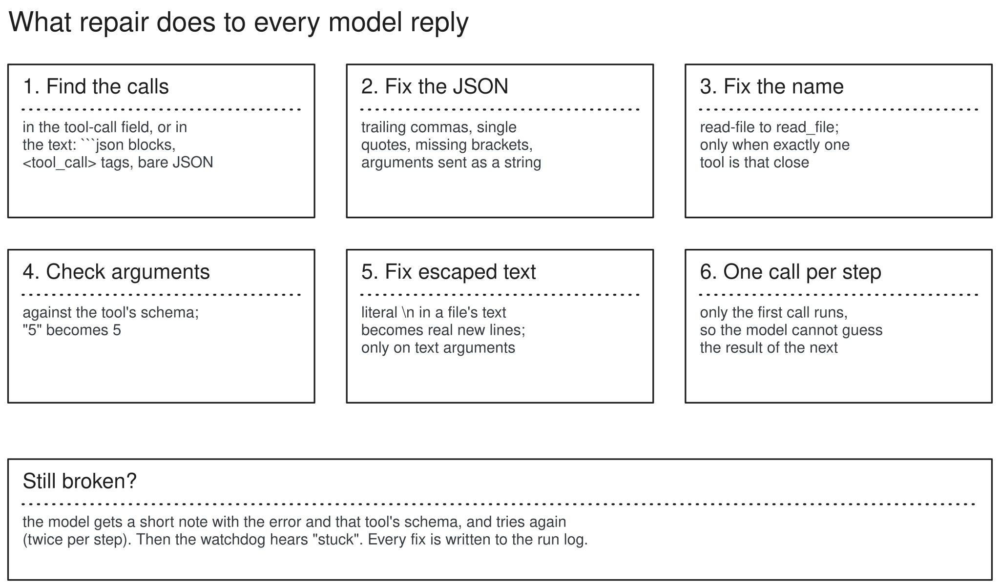

# Reliability layer (M4)

Small models break tool calls in predictable ways. M4 catches those breaks, fixes what can be fixed safely, gives the model two more tries when it cannot, and raises a clear "stuck" signal when nothing works. M4.5 (the model ladder) uses that signal to step up to a bigger model.

## Structure



- `providers/` stops raising on a broken `arguments` string: the call comes back with `arguments_text` (the raw text) and `arguments_error`. Providers still know nothing about tools.
- `providers/profiles.py` asks a local backend what the model can do (Ollama `/api/show`, `/api/ps`, `/api/tags`; llama.cpp `/props`; nothing elsewhere, and never a remote backend) and caches it in `~/.cache/kestrel/profiles.json`. `cli/agent_run.py` applies it before each run (refuse a model without tools, lower the window, thinking off).
- `reliability/repair.py` is a pure function: model reply plus tool specs in, checked calls (or a corrective note) out. The loop calls it between the model and the tools.
- `reliability/watchdog.py` watches the calls and results step by step and emits `loop_warning` and `stuck`. `run_agent(on_stuck=...)` is where M4.5 plugs in a bigger model; without it, stuck stops the run.
- `reliability/nudge.py` (M4.2) is a pure check on a reply with no tool call: does it end by announcing an action ("Let me do that for you.")? If so the loop keeps the reply, adds one note as a user message starting `(Kestrel:` and asks again, once per run (`nudge` event). The context manager never treats such a note as the user's message, so the real task stays pinned.
- Tools raise `ToolError` for failures the model should fix (no such file, no match); the result is `is_error`, so the watchdog's "errors in a row" counts it and it is not wrapped as untrusted.
- Every model request logs the exact messages sent; `/trace ID --prompt N` shows them, and `/report-failure` saves a step as a case for `tests/fixtures/bad_outputs/` (48 cases so far, one test runs them all).

## How a reply is handled



## Data, before and after

The real qwen3:8b case from the M3 demo, double-escaped new lines:

```python
# before: what the model sent (arguments as received)
{"path": "report.md", "content": "# Line Count Summary\\n- **demo/interact.py**: 19 lines\\n- **Total**: 160 lines"}
# the file got one line with literal \n in it

# after repair step 5 (content is a text argument, has no real new line, has 2+ literal \n)
{"path": "report.md", "content": "# Line Count Summary\n- **demo/interact.py**: 19 lines\n- **Total**: 160 lines"}
# run log: {"type": "repair", "data": {"kind": "unescape_text", "arg": "content", "before": "...", "after": "..."}}
```

The real qwen3:8b case from the M2 demo, a guessed result:

```python
# before: two calls in one step; the second already uses a sum it has not seen
[add(a=17, b=25), echo(text="the sum is 42")]
# after repair step 6: only add runs; its result says
# "(Only this call ran: one tool per step. Call others again if still needed.)"
```

A broken call that used to end the run:

```python
# before: provider raised BadBackendResponseError, stopped_reason=error
ToolCall(name="read-file", arguments_text="{'path': 'notes.txt',}")
# after: name fixed (read-file to read_file), quotes and trailing comma fixed
ToolCall(name="read_file", arguments={"path": "notes.txt"})
```

When nothing can fix it, the model sees (about 80 tokens):

```text
ERROR: your call to write_file could not be used: content: Field required.
write_file expects: {"path": string, "content": string, "overwrite": boolean (optional)}.
Call it again with valid arguments.
```

A reply that announces but does not act (M4.2, qwen3:8b, from the owner's chat):

```text
# before: the turn ended here and nothing happened
assistant: ... I need to open the file, add the new entry, and save it. Let me do that for you.
# after: one note, one more try
user: (Kestrel: you said you would do something but made no tool call, so nothing happened.
       If a tool is needed, call it now. Otherwise give your final answer.)
# run log: {"type": "nudge", "data": {"said": "... Let me do that for you."}}
```
