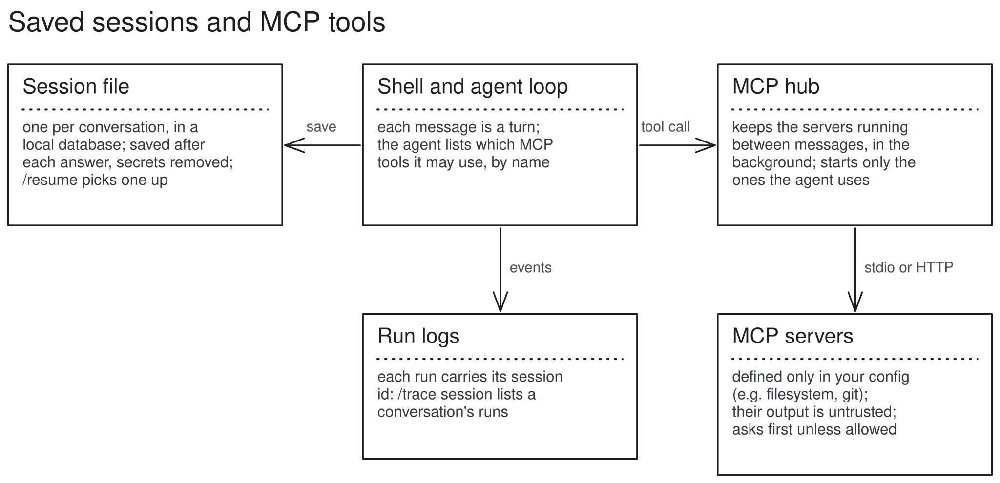

# Saved sessions and MCP tools (M5)

The shell already is the interactive chat. M5 adds two things: conversations are saved and can be resumed, and agents can use tools from MCP servers you configure.

## Structure



### Sessions
- `<data dir>/sessions.db` (SQLite, owner's choice): a `sessions` row per conversation (workspace, title, agent, provider, model, ladder), its `messages` (tool calls and results included) and its `runs`. Secrets are removed like in run logs.
- Saved after each kept turn and after `/retry`; a session exists from its first kept turn. Not saved: cloud on/off, `/up`, which files were read (after resuming, the model reads a file again before editing it).
- Every run's `run_start` carries the session id, so `/trace session` lists a conversation's runs.
- Commands: `/sessions` (the last 20), `/resume [id|last]` (a menu without an id), `kestrel --resume ID`. `/clear` starts a new session.

### MCP
- `tools/mcp.py` with the official `mcp` SDK (pinned), used only there.
- `McpHub`: one background event loop for the whole shell; each server is started once, by the first turn of an agent that uses it, and kept until you leave (`/mcp restart NAME` to restart). Tool calls cross into it and Esc still stops them.
- Servers are defined only in your config, never in agent files:

```toml
[mcp_servers.fs]
command = "npx"
args = ["-y", "@modelcontextprotocol/server-filesystem", "{workspace}"]
allow = ["read_text_file", "list_directory"]   # these skip the confirm prompt

[mcp_servers.git]
command = "uvx"
args = ["mcp-server-git", "--repository", "{workspace}"]
env_pass = ["GITHUB_TOKEN"]                     # by name; values never in the file
```

- Agents pick tools by name: `mcp: {fs: [read_text_file, list_directory], git: ["*"]}`. They appear to the model as `fs__read_text_file`. More than 12 tools in total warns; more than 24 is refused (small models choose badly from long lists).
- Each tool's description and schema are trimmed for small windows (about 200 tokens per tool (two filesystem tools measured about 400)).
- Results: text joined; images noted as omitted; errors become error results. Everything from a server, errors included, is wrapped as untrusted (`mcp:fs/read_text_file`). Default permission: confirm, except tools in the server's `allow` list.
- A server's own messages go to `<data dir>/mcp/<name>.log`, not the screen. HTTP servers off this machine count as cloud and need the agent's `allow_cloud`.
- Commands: `/mcp` (servers and whether each is running), `/mcp tools [server]`, `/mcp restart NAME`.

## How an MCP call runs

1. You switch to an agent that lists `fs` tools; on its first message Kestrel starts the `fs` server (the command is printed) and lists its tools.
2. The model sees `fs__read_text_file` with a trimmed description.
3. It calls the tool; unless the tool is in `allow`, you are asked first.
4. The hub sends the call to the running server and waits (30 s by default).
5. The result comes back wrapped as untrusted and goes to the model; the run log has the call and the result.

## Data, before and after

```text
# shell
⏺ fs__list_directory(.)
  ⎿  [FILE] sales.csv
     [DIR] demo

# what the model is given
<untrusted source="fs__list_directory:.">
[FILE] sales.csv
[DIR] demo
</untrusted>

# sessions.db, after the turn (one row per message)
sessions: id 20261114-061502-a1b2, title "what is in data?", agent default, model qwen3:8b
messages: 0 user, 1 assistant (call), 2 tool (result), 3 assistant (answer)
```

Done when: the filesystem server (jailed to the workspace) and one third-party server (`markitdown-mcp`, or `mcp-server-git`) work end to end in the shell, and a session can be closed and resumed.
