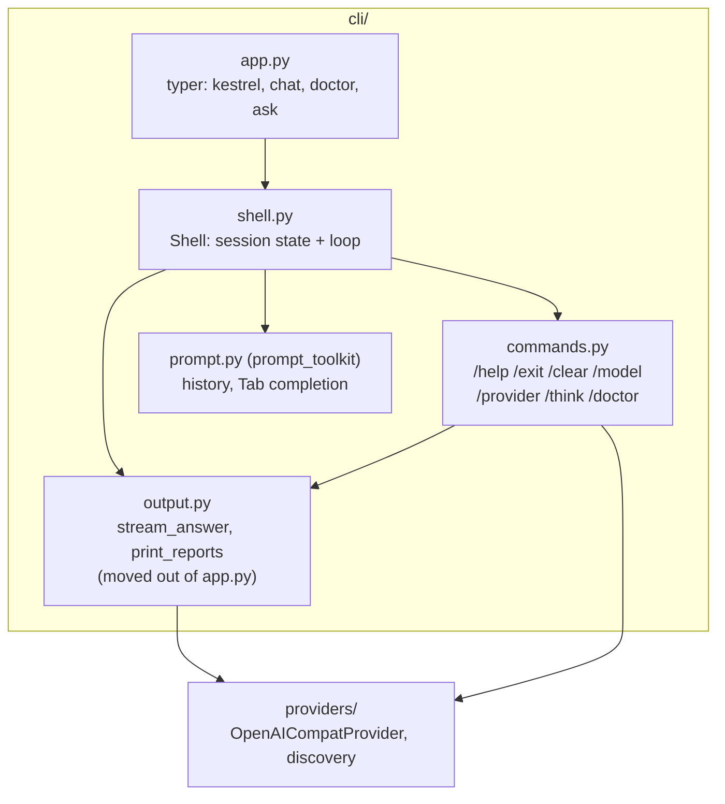
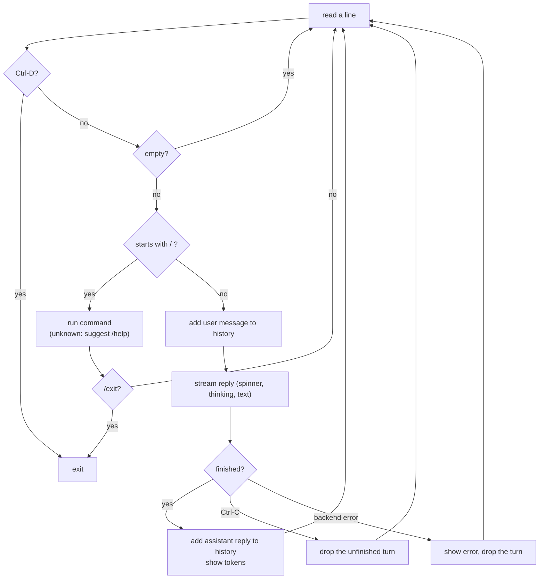

# Interactive shell (M1.5)

`kestrel` with no arguments (or `kestrel chat`) opens Kestrel's own prompt. Plain text goes to the model; `/` commands control the session. `kestrel doctor` and `kestrel ask` keep working from the normal terminal.

## Structure



`Shell` takes a `read_line` function. The real one is prompt_toolkit; tests pass a list of scripted lines and a `FakeProvider`, so no terminal and no model are needed.

## How one line is handled



Ctrl-C at the prompt only clears the line. A turn that failed or was stopped is removed from history, so the next message starts clean.

## Data, before and after

Session state after two turns:

```python
Session(
    provider="ollama",
    model="qwen3:8b",
    show_thinking=False,
    history=[
        Message(role=Role.user, content="My name is Jag."),
        Message(role=Role.assistant, content="Nice to meet you, Jag!"),
        Message(role=Role.user, content="What is my name?"),
        Message(role=Role.assistant, content="Your name is Jag."),
    ],
)
```

Every turn sends the whole `history` (that is how the model "remembers"). Reasoning is not kept in history. `/clear` empties it. `/model gemma3:4b` changes `model` and keeps `history`.

Limit until M2's context manager: history must fit the model's context (16K). Ollama silently drops the oldest part when it does not fit, so the shell shows the prompt token count each turn and warns above 12K tokens to `/clear`.
