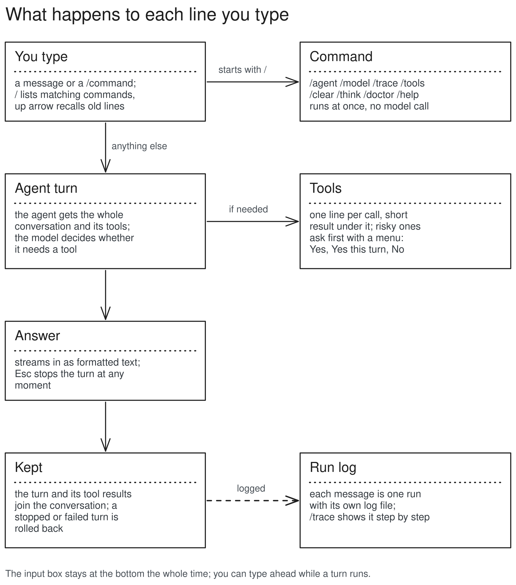

# Interactive shell (M1.5, reworked in M3.5)

`kestrel` with no arguments (or `kestrel chat`) opens Kestrel's own prompt. Every message is one agent turn: the agent gets the conversation so far plus its tools and decides itself whether to use them. `/` commands control the session. `kestrel doctor`, `kestrel ask` and `kestrel run` keep working from the normal terminal.

## Structure



- `Shell` (`cli/shell.py`) takes a `read_line` function. The real one is `InputBox` (`cli/prompt.py`, prompt_toolkit); tests pass scripted lines and a `FakeProvider`, so no terminal and no model are needed.
- `Shell.send` calls `start_run` (`cli/agent_run.py`) with `Session.conversation`, a `ContextManager` that lives as long as the shell. The run adds to it; a stopped or failed turn is cut back out.
- `CliFrontend` (`cli/frontend.py`) draws the run. `watch_stop_keys` (`cli/keys.py`) puts the terminal in raw mode during a turn so Esc or Ctrl-C cancels it; the permission menu and `ask_user` pause it so they get the keys.
- No terminal attached (pipes, tests): plain typed y/n/a answers and plain answer text.

## How one message is handled

1. The input box closes and the message is printed as `> message`.
2. `start_run` sets the conversation's system prompt, window and tool list from the current agent (so `/agent` can switch between messages).
3. The agent loop runs: the context manager trims old turns to fit, the model streams, tools run through the permission gate.
4. The answer is drawn as markdown after a `⏺`; a summary line gives steps, tools, tokens, seconds and the run id.
5. The turn stays in the conversation if it ended normally or hit a limit; it is rolled back on Esc, Ctrl-C or a backend error.

## Data, before and after

The screen for one message:

```
> what is the total revenue per region in data/sales.csv?

⏺ read_file(data/sales.csv)
  ⎿  data/sales.csv: 7 lines total
     1| month,region,units,price
     2| jan,north,120,9.5
     … +5 lines
⏺ python_exec(import csv…)
╭─ python_exec wants to run ───────────────╮
│ import csv                               │
│ ...                                      │
╰──────────────────────────────────────────╯
  ⎿  allowed
  ⎿  exit code 0
     north 3755.0
     south 2742.5
⏺ North made 3755.0 and south 2742.5.
  3 steps · 2 tools · 4.1K tokens · 41s · run 20261112-091502-8f3a

╭──────────────────────────────────────────╮
│ >                                        │
╰──────────────────────────────────────────╯
  qwen3:8b · agent default · context 18% of 16K · /help
```

The conversation after it (what the next message builds on):

```python
[
    Message(role=user, content="what is the total revenue per region in data/sales.csv?"),
    Message(role=assistant, tool_calls=[read_file(path="data/sales.csv")]),
    Message(role=tool, content='<untrusted source="read_file:data/sales.csv">...'),
    Message(role=assistant, tool_calls=[python_exec(code="import csv...")]),
    Message(role=tool, content='<untrusted source="python_exec">exit code 0 ...'),
    Message(role=assistant, content="North made 3755.0 and south 2742.5."),
]
```

When it grows past the window, old tool results are emptied first, then the oldest turns are dropped. The newest message from you is never dropped. Reasoning is never kept.
